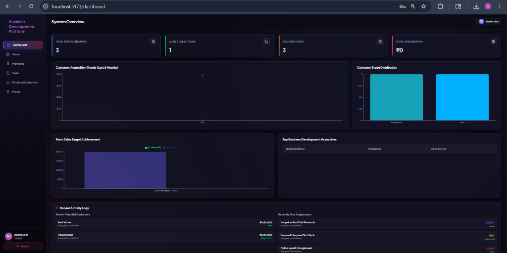
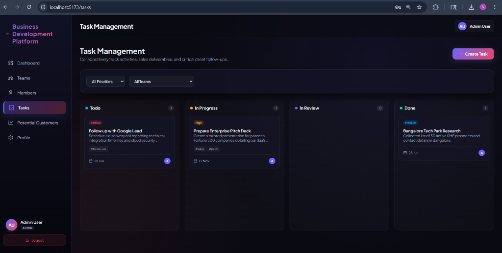
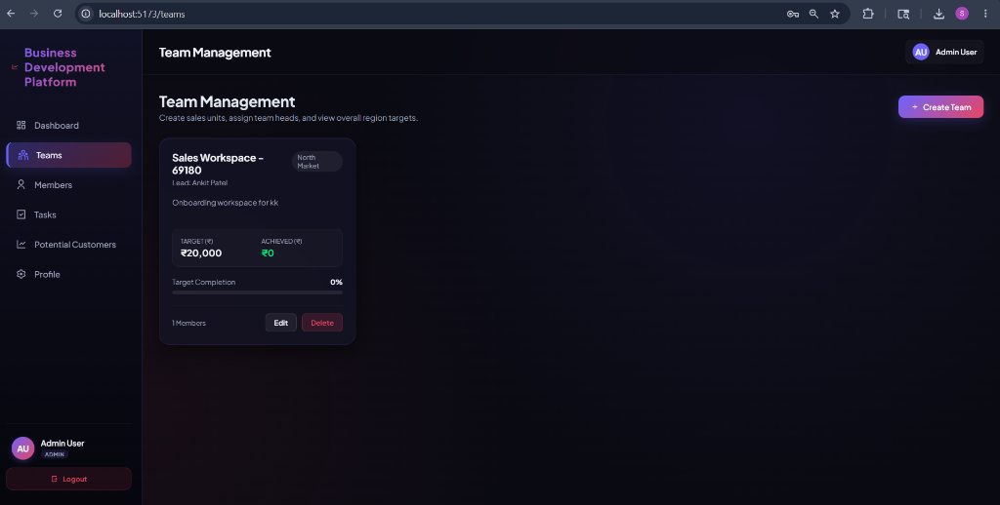
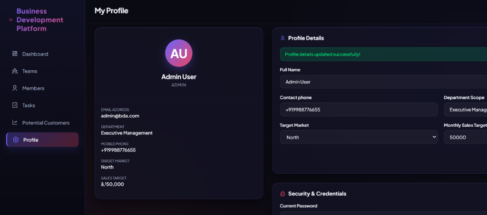

# BDA Team Management System

A full-stack **Business Development Associate (BDA) Management Platform** built with the MERN stack (MongoDB, Express.js, React, Node.js). This CRM application helps organizations manage their sales teams, track potential customers through a sales pipeline, and boost productivity with AI-powered tools.

## ✨ Features

### 🔐 Authentication & Roles
- JWT-based login/register system
- Three user roles: **Admin**, **Team Manager**, **Business Development Associate (BDA)**
- Role-based data isolation and access control enforced at both database query and route levels

### 📊 Dashboard & Analytics
- Real-time stats: Total Revenue, Potential Customers, Active Tasks, Active Teams
- Dynamic calculation of team revenue achieved directly from won deals
- Interactive charts (Pipeline Distribution, Team Performance)
- Top Business Development Associates leaderboard

### 👥 Team Management
- Create and manage sales teams
- Assign managers and team members
- Track team-level sales targets and live won achievements

### 📋 Task Management
- Create, assign, and track tasks
- Role-aware task delegation (managers assign within team, associates track assigned tasks)
- Kanban-style status tracking (To Do, In Progress, Review, Done)
- Priority levels and due dates

### 🎯 Lead / Potential Customer Management
- Full sales pipeline: New → Contacted → Qualified → Proposal → Negotiation → Won/Lost
- Track deal values, sources, and follow-up dates
- Role-scoped pipeline, CSV export, and assignment flow

### 🌐 Public Contact Page
- Public-facing `/contact` page (no login required)
- Customers can submit inquiries directly
- Submissions automatically appear as unassigned leads in the CRM for admin review

### 🤖 AI Email Drafter (Grok AI)
- One-click AI-generated follow-up emails for any lead
- Powered by Grok (xAI) API
- Personalized based on customer name, company, and discussion notes
- Copy-to-clipboard functionality

## 👥 Roles and Assignment

For detailed architecture and visibility rules across all roles, see [ROLES.md](ROLES.md).

- **Administrator (`admin`)**: Complete system oversight. Can view all teams, members, tasks, and leads. Can create and manage teams and assign members.
- **Team Manager (`manager`)**: Scoped to their own managed team. Can view and assign tasks and leads within their team, and add unassigned members to their team.
- **Business Development Associate (`bda`)**: Scoped strictly to records assigned directly to them. Public registration creates an unassigned BDA with clean zero-state until assigned to a team by a manager or administrator.

### 🧪 Database Seeding and Setup Key

The system connects directly to MongoDB:
- Seeded records (e.g. `admin@test.com`, `manager@test.com`, `bda@test.com` with password `password123`) are demo/test data.
- The `POST /api/setup` endpoint requires the `SETUP_KEY` environment variable configured on the backend server.
- The endpoint will reject requests if any user already exists in the database to prevent accidental data overwrites.

## 🛠️ Tech Stack

| Layer | Technology |
|-------|-----------|
| Frontend | React 18, Vite, React Router v6 |
| Backend | Node.js, Express.js |
| Database | MongoDB Atlas (Mongoose ODM) |
| Auth | JWT (JSON Web Tokens), bcrypt |
| AI | Grok API (xAI) |
| Styling | Clean SaaS Design |
| Charts | Recharts |

## 🚀 Getting Started

### Prerequisites
- Node.js (v18 or above)
- MongoDB Atlas account (free tier works)
- Grok API key (optional, for AI features)

### 1. Clone the Repository
```bash
git clone https://github.com/YOUR_USERNAME/bda-team-management.git
cd bda-team-management
```

### 2. Setup Backend
```bash
cd backend
npm install
```

Create a `.env` file in the `backend/` folder:
```
PORT=5000
MONGO_URI=your_mongodb_connection_string
JWT_SECRET=your_secret_key
JWT_EXPIRE=7d
NODE_ENV=development
CLIENT_URL=http://localhost:5173
SETUP_KEY=your_private_setup_key
GROK_API_KEY=your_grok_api_key
```

Start the backend:
```bash
npm run dev
```

### 3. Setup Frontend
```bash
cd frontend
npm install
npm run dev
```

### 4. Open in Browser
- Frontend: `http://localhost:5173`
- Backend API: `http://localhost:5000`
- Public Contact Page: `http://localhost:5173/contact`

## 📁 Project Structure
```
bda-team-management/
├── backend/
│   ├── config/          # Database connection
│   ├── controllers/     # Business logic (auth, leads, tasks, teams, AI)
│   ├── middleware/      # JWT auth, role authorization & error handling
│   ├── models/          # MongoDB schemas (User, Lead, Task, Team)
│   ├── routes/          # API endpoints
│   ├── utils/           # Scope helpers & seeder
│   └── server.js        # Express app entry point
├── frontend/
│   ├── src/
│   │   ├── api/         # Axios instance
│   │   ├── components/  # Reusable UI (Layout, Sidebar, Table, Modal)
│   │   ├── context/     # Auth context (React Context API)
│   │   ├── pages/       # All page components
│   │   └── App.jsx      # Router setup
│   └── index.html
├── ROLES.md             # Role-based scoping documentation
└── README.md
```

## 📸 Application Walkthrough

### 📊 Executive Analytics Dashboard
A comprehensive view of the sales pipeline, team performance, lead distributions, and real-time activity logs.


### 📋 Kanban Task Management
Visual task allocation and tracking across customizable stages (To Do, In Progress, Review, Done) with priority indicators.


### 👥 Team Target Coordination
Enables administrators and managers to monitor regional sales targets, track achievement percentages, and configure member structures.


### 👤 User Profile & Workspace Details
Allows team members to manage contact information, check department scopes, and view individual sales targets.


## 📄 License
This project is for educational purposes.
